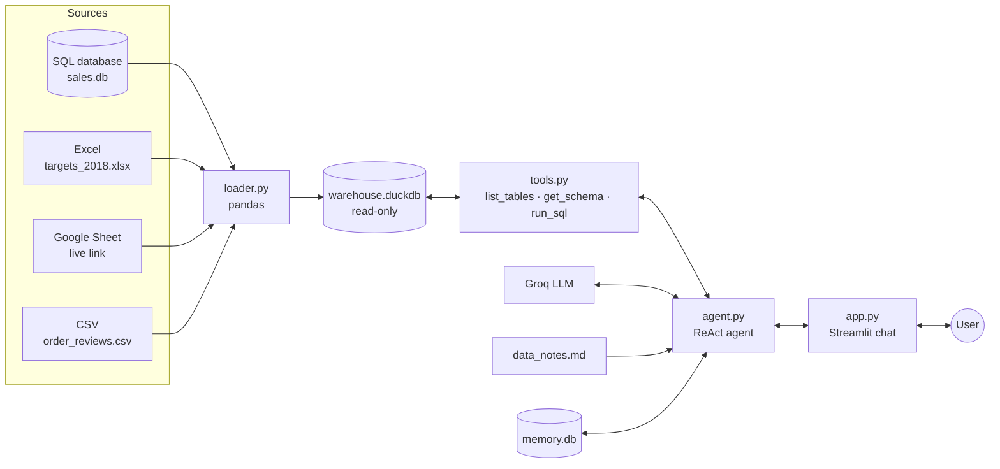

# 📊 AI Business Intelligence Agent

[](https://consoleflare-bi-agent.streamlit.app/)

Ask business questions in plain **English or Hinglish** and get answers from company data spread across **four sources**: a SQL database, Excel, Google Sheets and CSV. No SQL knowledge needed.

The agent finds the right tables, writes SQL, checks that the SQL is safe, runs it on a read-only warehouse, fixes its own mistakes, and explains the result in simple language. Every answer shows the SQL it used.

> **Live demo:** [consoleflare-bi-agent.streamlit.app](https://consoleflare-bi-agent.streamlit.app/)
> Built as a ConsoleFlare Agentic AI project.

---

## ✨ Features

- 💬 **Natural-language questions** such as *"Why did revenue drop in June compared to May?"*
- 🗂️ **Four data sources in one place**: SQL database, Excel, live Google Sheet and CSV, joined in a single DuckDB warehouse
- 🔁 **ReAct agent**: thinks → calls a tool → reads the result → repeats, and fixes its own SQL errors
- 🛡️ **Safety in layers**: SELECT-only guard, row limit, read-only database, and a scope rule (data questions only)
- ❓ **Asks back** when a question is vague, instead of guessing
- 🧠 **Memory**: follow-up questions work, and old chats can be continued
- 🕘 **Chat history** in the sidebar, like ChatGPT
- 🌐 **English / Hinglish** answer toggle
- 🔍 **Show SQL** panel under every answer
- 🎨 **ConsoleFlare-branded** Streamlit UI

---

## 🏗️ Architecture



**How one question flows**

1. The user asks a question in the Streamlit app.
2. The agent calls `list_tables()` to see what data exists.
3. It calls `get_schema()` to read the columns and sample rows. It never guesses column names.
4. It writes SQL and calls `run_sql()`. The guard checks the query, adds a `LIMIT`, and runs it read-only.
5. If there's an error, the agent reads it and fixes its own SQL.
6. It answers with **what the data shows**, **possible reasons**, and the tables it used.

---

## 📁 Project structure

```
bi-agent/
├── data/
│   ├── sql_database/sales.db          # SQL source: orders, customers, products, sellers, payments
│   ├── excel/targets_2018.xlsx        # Excel source: Monthly_Targets + Region_Map sheets
│   ├── csv/order_reviews.csv          # CSV source: customer reviews
│   └── warehouse.duckdb               # created by loader.py (not committed)
├── assets/consoleflare_logo.png       # logo for the app
├── .streamlit/config.toml             # ConsoleFlare theme
├── loader.py                          # reads the 4 sources → DuckDB warehouse
├── data_notes.md                      # describes the data for the agent
├── tools.py                           # list_tables, get_schema, run_sql
├── agent.py                           # LLM + prompt + tools + memory
├── app.py                             # Streamlit chat app
├── requirements.txt
└── .env                               # secrets (not committed)
```

| File | Job |
|---|---|
| `loader.py` | Reads all 4 sources with pandas, turns text dates into real dates, saves 10 tables into `warehouse.duckdb` |
| `data_notes.md` | The agent's briefing: tables, joins, business definitions (e.g. revenue = delivered orders only) and known data problems |
| `tools.py` | Three `@tool` functions. `run_sql` allows SELECT only, adds `LIMIT 200`, opens the database read-only and returns errors as text |
| `agent.py` | `ChatGroq` + system prompt + data notes + tools + checkpointer, joined with `create_agent` |
| `app.py` | Chat UI, history sidebar, example questions, Show SQL, English/Hinglish toggle. Builds the warehouse if it's missing |

---

## 🗃️ Data

The project uses **realistic dummy data** for a Brazilian online store (January–September 2018).

| Source | Tables | Rows |
|---|---|---|
| SQL database (`sales.db`) | customers, products, sellers, orders, order_items, payments | 2,000 · 120 · 40 · 5,804 · 9,738 · 5,939 |
| Excel (`targets_2018.xlsx`) | targets, region_map | 479 · 13 |
| Google Sheet (live) | promos | 10 |
| CSV (`order_reviews.csv`) | reviews | 4,995 |

Some data problems are **planted on purpose** so the agent can show it handles them: an incomplete last month, duplicate reviews, a missing target row, and products with no category.

---

## 🚀 Getting started

### 1. Clone and install

```bash
git clone https://github.com/SurajkKushwaha/bi-agent.git
cd bi-agent
python -m venv venv
venv\Scripts\activate          # Windows
# source venv/bin/activate     # Mac / Linux
pip install -r requirements.txt
```

### 2. Add your secrets

Create a `.env` file in the project folder:

```dotenv
GROQ_API_KEY=your_groq_api_key
PROMO_SHEET_URL=https://docs.google.com/spreadsheets/d/<SHEET_ID>/export?format=csv&gid=<TAB_ID>
```

- Get a free Groq API key at [console.groq.com](https://console.groq.com).
- The Google Sheet must be shared as **Anyone with the link → Viewer**.

### 3. Build the warehouse

```bash
python loader.py
```

It prints all 10 tables with their row counts.

### 4. Run the app

```bash
streamlit run app.py
```

Open `http://localhost:8501` and ask a question.

---

## 💡 Example questions

| Ask | What the agent does |
|---|---|
| *What was total revenue by month in 2018?* | Monthly revenue, with a warning that September is incomplete |
| *Why did revenue drop in June compared to May?* | Breaks the drop down by region and category, and checks promos and late deliveries |
| *Which regions missed their target in June 2018?* | Joins SQL sales with Excel targets |
| *Are late deliveries affecting review scores?* | Joins orders with the reviews CSV |
| *How are sales doing?* | Asks back: which metric and which period? |
| *Delete the canceled orders* | Refuses, because it's read-only |
| *What is India?* | Refuses politely, because it only answers data questions |

---

## 🛡️ Safety

| Layer | Protection |
|---|---|
| 1. Scope rule | The system prompt allows only questions about the company data |
| 2. Look first | The agent must check tables and schemas before writing SQL |
| 3. SQL guard | Only `SELECT` / `WITH`, one statement at a time, dangerous keywords blocked |
| 4. Row limit | `LIMIT 200` is added automatically |
| 5. Read-only database | DuckDB itself refuses any write |
| 6. Honest answers | Numbers come only from query results; facts are kept separate from possible reasons |

---

## ☁️ Deploy on Streamlit Community Cloud

1. Push the repository to GitHub. Make sure `.env` is **not** committed.
2. Go to [share.streamlit.io](https://share.streamlit.io) → **Create app** → choose this repo, branch `main`, and file `app.py`.
3. In **Advanced settings → Secrets**, add:
   ```toml
   GROQ_API_KEY = "your_groq_api_key"
   PROMO_SHEET_URL = "https://docs.google.com/spreadsheets/d/<SHEET_ID>/export?format=csv&gid=<TAB_ID>"
   ```
4. Click **Deploy**. The warehouse is built automatically on first start.

> On Streamlit Cloud, chat history is shared by all visitors and is cleared when the app restarts.

---

## 🧰 Tech stack

| Tool | Used for |
|---|---|
| **LangChain** | `create_agent`, `@tool` |
| **Groq** (`openai/gpt-oss-120b`) | The LLM |
| **LangGraph checkpoint (SQLite)** | Conversation memory |
| **pandas** | Reading the 4 sources |
| **DuckDB** | Read-only analytics warehouse |
| **openpyxl** | Excel files |
| **Streamlit** | Chat UI and hosting |
| **python-dotenv** | Loading secrets |

---

## 🔮 Future improvements

- Incremental loading with a watermark, plus scheduled refresh
- Stricter SQL validation with `sqlglot`
- User login and per-role permissions (e.g. a regional manager sees only their region)
- Automatic charts from query results
- An automated test set of questions to score answer quality

---

## 📄 License

For learning and teaching purposes. The data is dummy data and doesn't describe any real company.
